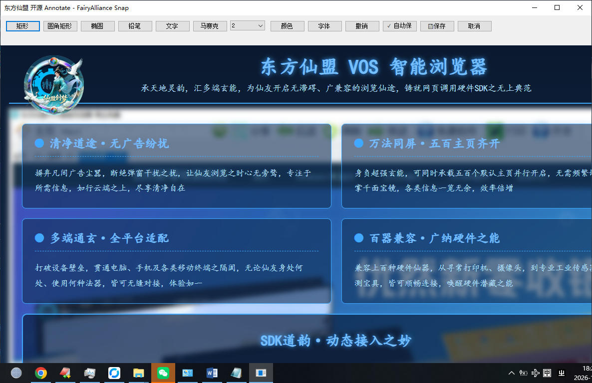
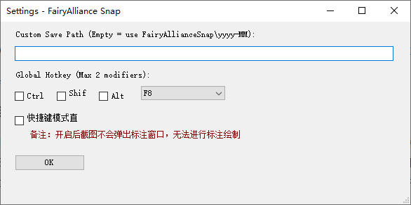

# CyberWin · FairyAllianceSnap
> Open‑source Windows screenshot tool of CyberWin suite, built with .NET.


Gitee Repo: https://gitee.com/cybersnow/CyberWin_NET_FairyAllianceSnap

## Introduction
**FairyAllianceSnap** is a local screen‑capture component for Windows under the CyberWin open‑source project.
Written in C#/.NET. You can run it as a standalone screenshot utility, or reference it as a library inside your other .NET desktop applications.
All image processing runs locally. No screenshot data will be sent over network.

## Features
- Capture full‑screen, single‑window or custom selected region on Windows
- Export screenshot to clipboard or local image file
- Component‑oriented design for easy integration
- Light‑weight, no extra background service
- Open‑source code, privacy‑friendly, works on Windows10 / Windows11

## Architecture
Main entry: `CyberWin_SnapApp.cs` under src folder.
Target runtime: .NET Framework / .NET

## Installation
### Binary Release
Download artifacts from Releases page, unzip and run `FairyAllianceSnap.exe`.

### Build from Source
```bash
git clone https://gitee.com/cybersnow/CyberWin_NET_FairyAllianceSnap.git
